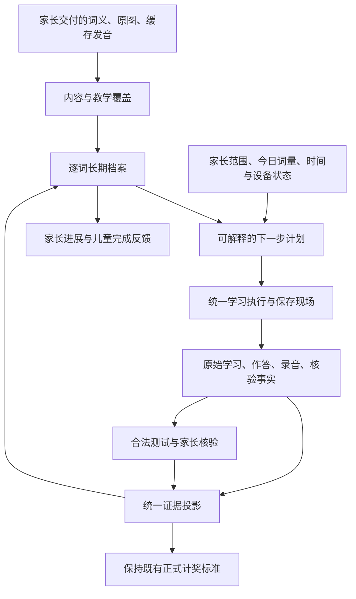

# 词档案驱动的学习体系重构

本方案承接用户“先对标、建立完整重构规划与任务树，再开始推进”的授权。执行状态只维护在 [任务树](TASK_TREE.md)，验收只维护在 [当前验收](ACCEPTANCE.md)。本文件定义目标体系、参考依据和迁移合同，不充当第二份进度表。

## 1. 重构目标

每个词在当前义项下有长期学习档案。今天的学习由这些档案、已教内容、有效测试结果、到期目标和可用时间共同生成。一次学习现场只负责执行和恢复，孩子无需管理多份轮次。

- 学过的事实持续保留；测试发现薄弱时只调整需要练的目标。
- 学习完成、录音保存、测试待核验、独立通过和隔日稳定分别记录。
- 同一词可以听得懂但说不出；计划针对具体能力安排，不把整个词一律从头重学。
- 已教词义不等于已教某个句式。测试须核对实际教学覆盖及所见题面版本。
- 新学习与中途继续都保留，但每个模式只有一个当前任务。继续恢复原题；新任务替换旧现场，逐词接触、回答、原音和核验结果独立保留。

## 2. 明确参考对象与借鉴范围

以下依据为核对过的官方产品说明；尚未代表在本机安装并实测这些应用，也不作为本项目孩子效果的证据。选择依据是问题匹配、机制明确、可执行和证据可追溯；本项目不以商业利润筛选儿童学习机制。

| 参考对象 | 官方明确的机制 | 本项目借鉴 | 适用边界与不照搬部分 |
| --- | --- | --- | --- |
| Khan Academy Kids | 主播放入口进入学习路径；依据各主题表现调整进度，对薄弱组成部分增加练习或支架 | 一个清楚的下一步入口；以具体能力状态产生后续任务；家长查看跨活动累计的进展 | 面向2–8岁多领域学习，不能把其英语母语课程顺序直接套成中文母语词汇课 |
| Anki | 新卡、学习中与复习队列分开；每卡保留历史并按回答更新下次安排；调度参数与学习负担有关 | 单词档案与一次任务清单分离；保留历史，失败进入补练；给出安排原因和下次时间 | 儿童不自行选择难度按钮；录音不是回答判定；当前少量单孩数据不拟合或宣称FSRS记忆概率 |
| Duolingo ABC | 短时互动活动、循序支架、不同起点与自主使用，课程覆盖识音、解码、理解等不同能力 | 一屏一个明确动作、短反馈、由支持过渡到独立尝试；能力方向分开记录 | 其核心为英语早期阅读，不能将朗读流利直接当作理解词义或自主表达 |
| Google Read Along | 获得麦克风权限后朗读；需要帮助时点角色或词，朗读与按需示范分开 | 开麦及聆听状态可见；示范按需触发；完成与失败有清楚出口 | 本项目本地音量与停顿不识别内容；不仿造该产品的识读能力或把自动反馈写成正式口头成绩 |

官方来源：

1. [Khan Academy Kids Learning Path](https://khankids.zendesk.com/hc/en-us/articles/360048828572-Learn-more-about-the-Learning-Path)：按主题能力调整路径，已掌握内容可更快通过，薄弱部分提供练习与支架。
2. [Khan Kids parent resources](https://khankids.zendesk.com/hc/en-us/articles/360047433311-List-of-resources-for-parents)：提供自主学习路径、可自选的内容库和家长/教师进展查看入口；具体报告入口以官方当前界面为准。
3. [Anki Studying](https://docs.ankiweb.net/manual/studying)、[Anki Deck Options](https://docs.ankiweb.net/manual/deck-options)：卡片状态、回答与安排的关系，以及间隔、历史、保留率和负担的边界。
4. [Duolingo ABC how we teach](https://abc.duolingo.com/how-we-teach)：短活动、分级起点、支架和独立使用的产品机制。这里引用机制，不采用其宣传性效果数字。
5. [Read Along reading workflow](https://support.google.com/readalong/answer/12291548?co=GENIE.Platform%3DDesktop&hl=en)：朗读、麦克风和按需读词/示范的操作关系。

产品机制到本项目的取舍是设计判断，并非来源已经证明本项目适合某个算法或某种练习量。

正式切换后的优先候选是跨天短回忆。参照 [Leonard 等的儿童新词实验](https://pmc.ncbi.nlm.nih.gov/articles/PMC6802889/)，在已学词到期时先给无提示回忆机会，再按结果提供帮助。次日和第7天首次独立回忆用于观察，合适题量和间隔须结合孩子实际表现。Khan Academy Kids 的按分项表现调节难度可用于弱项补练，[Anki 的每日复习上限](https://docs.ankiweb.net/manual/deck-options#daily-limits)可用于限定单次负担，[Studycat 的跨情境再遇](https://studycat.com/about/methodology/)可作为后续迁移练习参考。

## 3. 当前体系的缺口

| 当前实现 | 确认的问题 | 重构落点 |
| --- | --- | --- |
| learning-history保存接触，learning-evidence校验测试来源 | 已学事实与有效证据已有基础，缺少统一、可解释的逐词状态 | RF02、RF03 |
| progress、assessmentProgress与growth分别计算 | 局部口径可能不同；“没有结论”和“答错”需要统一区分 | RF03、RF11、RF14 |
| dailyLearningPlan已有弱项和到期规则 | 旧现场仍逐项走冻结队列，不能充分反映别处的新证据 | RF05、RF06、RF07 |
| 各来源各自保存LearningSession | 新学习、续学、复习、加练、测试之间缺统一下一步 | RF06、RF08、RF12 |
| 当前测试补充了情境，短句学习正在接入 | 测什么必须由真正教过什么约束，旧录音不能倒填新语境 | RF10、RF11 |
| 多种题型已有统一基础框架 | 题面继续复用，但任务选择、状态更新与导航应由统一执行合同承接 | RF07、RF09、RF20 |

## 4. 目标架构

### 4.1 内容与身份

- 基础身份仍沿用现有wordId与learningVersion，逐词追溯原词书、义项、原图和发音。
- 跨书同词同义去重先作为可解释的候选映射；不凭英文拼写直接合并不同义项或历史。自动合并不是首批迁移步骤。
- 义项或题面版本变更保留历史，当前档案只引用合法版本。原媒体内容不因状态重构改变。
- 情境/句式是教学覆盖，不是单词掌握分数；完成补学也不自动通过口头测试。

### 4.2 事实、证据与长期状态

三层分开：原始事实不可被投影覆盖；证据核对来源、版本、时间和提示；档案由证据确定当前状态及下一步原因。

| 对外状态 | 进入依据 | 默认下一步 |
| --- | --- | --- |
| 未学习 | 当前义项没有合法接触或学习证据 | 初次认识 |
| 学习中 | 有接触或保存现场，初学目标尚未完成 | 继续未完成目标 |
| 学过待检查 | 已有学习，仍缺有效的目标结论 | 补必要测试/检查 |
| 需要巩固 | 当前合法回答显示答错或依赖词汇帮助 | 只练薄弱方向 |
| 已学会 | 四项正式方向均有有效独立通过 | 按到期安排再遇 |
| 已熟练 | 四项各有不同日期的独立通过证据 | 随到期间隔继续检查 |

- 状态之外保留认义、听辨、回忆、朗读及可选拼写的分项证据。
- 待核验、跳过和设备不可用各自显示；它们本身不证明不会，也不能抹掉此前合法通过。
- 最新有判断意义的回答决定强弱；晚核验的旧录音不覆盖更新回答。永久奖励账本不因投影变化回滚。
- 首批“较稳定”沿用可解释的跨日期证据规则；不生成0–100熟练分或未经拟合的记忆概率。

### 4.3 计划器

输入：当前档案、合法内容、已教覆盖、到期目标、家长范围/顺序、今日设置、当前现场与实际时间。

输出为有限目标清单，每项包含词、能力/内容目标、安排原因、证据引用、预计负担与必要支架。任务数量和词数分别统计。

1. 保存并处理正在执行的现场；录音/请求结束前不更换当前题。
2. 需要补齐的教学覆盖先于相应测试。
3. 到期的明确弱项优先，再安排缺结论的已学目标和一般到期复习。
4. 当前组的词均学会后开放未学词。新组遵守家长范围及今日词量，穿插最多两个薄弱或到期旧词，每词一个待练方向。额外加练保持显式。
5. 同一词同一目标去重；被更新证据覆盖的未来任务注明被替代原因，不伪造一次完成或答对。
6. 未开始任务可在证据变化后重新规划；正在进行的题目、已完成事实及原音不重写。
7. 每个安排都能回答“为什么今天练这个、为什么只练这一项、何时再来”。

首批计划器先影子双算：保留正式执行结果，输出与旧计划差异，验证归因后再接管。固定间隔属于可版本化工程规则；个性化参数需要真实有效历史再评估。

### 4.4 统一执行与恢复

- 页面展示“开始今天的学习”“继续上次”“今天需要巩固的词”，保留新学习与续学能力。
- 内部可以保留session作为执行记录，前台不要求用户选择轮次。按书、课堂、自选仍是范围选择，不产生互相覆盖的词状态。
- 所有动作绑定计划版本、当前任务、内容版本和幂等请求ID。重复点击、刷新和迟到回调不能跳题或重复计账。
- 当前合法现场原位恢复；显式新任务创建成功后原任务退役。迁移保留当前指针对应现场，其他未结束历史活动不再成为儿童待办；逐词未学/待查/薄弱状态决定后续安排。
- 不把旧completedSteps批量写满，不用“跳过”伪装迁移完成；不删除旧轮次来简化页面。
- 录音保存、位置保存、退出和15/5休息保持既有失败出口。缺音如实显示，私有原音不进入公共媒体或普通日志。

### 4.5 测试、家庭反馈和奖励

- 只使用已交付内容、已教目标及合法题面版本测试；未教的新用法返回补学，不计错。
- 学习后检查用于发现待测与弱项；客观题可按有效答案记录，口头正式结论仍由家长按所见版本核验。
- 测试结果更新同一份词档案，家长核验后计划可更新；待核验不会无限触发整套重复学习。
- 家长按词查看证据、最后有效判断、待核验、薄弱方向和下一步；原始尝试可追溯，默认不堆工程状态。
- 成长与奖励复用现有四项正式独立通过及永久解锁合同；重构不降低门槛、不补虚构分数、不重复发奖。

### 4.6 儿童与家长的完整页面链

| 页面/情形 | 看见什么、主要做什么 | 状态与交互边界 |
| --- | --- | --- |
| 首页进入学习 | 有当前现场时突出继续；否则展示今天有限安排，点开始 | 进入和预览只读；新学习与继续上次保留，旧现场收在次级入口 |
| 初次认识 | 原词图、原义项和缓存发音，少量词先建立联系 | 认识事实立即长期保留；不会因退出或换入口退回未学习 |
| 理解与听辨 | 复用确认版选图/听选，自动播放与可重听状态明确 | 点选直接作答；提示与独立尝试分开，播放失败可退出或重试 |
| 朗读与主动回忆 | 朗读看英文；回忆先看原图/中文，独立尝试后才看/听示范 | 首次明确开麦；后续聆听状态可见；录音保存不等于正确，缺音不伪造完成 |
| 用法补学 | 先听/理解已确认短句，再带支持练习，最后独立检查 | 冻结已教句式版本与必要词汇支持；新句子不能直接拿旧单词录音作通过证据 |
| 定向巩固 | 只出现当前薄弱能力所需的题面 | 不把同词其他已通过方向全重学；同日重复练习不反复晋级 |
| 自主挑战 | 只检查已教目标，未教用法返回补学 | 客观判断与待核验口头回答分开；按所见版本核验后才更新正式证据 |
| 本次结束/休息 | 今天实际认识、练习、待核验的简洁反馈；一个明确返回动作 | 不用“完成一轮”冒充永久掌握；15/5休息与私有保存仍受原合同约束 |
| 家长词档案 | 按词看学习事实、分项能力、待核验、弱项和下次安排原因 | 可追溯原尝试；核验/历史回听继续鉴权；不让孩子自行判断熟练分 |
| 家长备课与范围 | 保留导入、词义预览、素材审核、交付及重点顺序 | 未交付、旧义项和缺素材不混进儿童计划；不自动生成或批准新素材 |

七类基础题面与连线维修延续用户已确认的主题、词图、帮助和底部布局；本次重构改变任务如何串起来，不重新发明各页按钮。整组连线/棋盘作为一个执行单元，不能只撤掉其中一个词导致另一个目标失效。

典型路径：新词先学后查；中途退出接回当前题；测试只在听辨出错就只补听辨；口头录音待核验时继续其他合法目标；全都完成且未到期时明确结束。主动选择从头学、按书加练或游戏仍保留，但不自动成为默认待办。

## 5. 模块与接口方向

| 层 | 职责 | 迁移方式 |
| --- | --- | --- |
| shared/word-learning.ts | 逐词证据、长期状态、原因与版本化只读投影 | 从现有事实推导，先不新增权威分数表 |
| shared/study-agenda.ts | 逐目标计划、优先级、去重、负担与解释 | 与旧调度同输入双算 |
| shared/study-continuity.ts | 旧题逐项映射、共用棋盘保护、续接请求合同 | 区分已存完成、保留当前、仍需执行、证据覆盖与内容阻塞，不修改旧记录 |
| server/study-read-model.ts | 只读组合档案/计划/现场及服务端版本绑定 | 内容/证据/日期/模式变化使旧请求失效；此合同本身不授予执行权限 |
| server执行层 | 幂等开始/继续、答题、原音与位置提交 | 新执行合同逐步承接旧API，保留兼容读取 |
| src学习协调层 | 从计划决定当前任务、导航与保存 | 拆出协调逻辑，复用已确认的题面框架 |
| 家长/成长层 | 解释逐词证据、核验与计奖 | 统一读取投影，正式事实边界保持 |
| scripts审计 | 原档案/媒体摘要、映射与差异报告 | 正式来源只读，输出仅到隔离证据目录 |

新接口在接管前须定义请求、响应、失败、幂等、模式隔离和旧调用兼容；不靠前端隐藏按钮绕过服务端验证。

统一执行合同：`GET /api/study`与AppState.study只读返回当前版本、三种用途的有限计划、逐词状态及现场摘要；`POST /api/study/start`校验version/mode/planId/requestId后原子保存请求回执和目标，按目标返回学习现场、短句补学或录音检查。新学、推荐、原学习恢复、原检查恢复和本次学后检查分别明确意图，客户端不能指定虚构完成或成绩。`POST /api/study/save`绑定原现场/当前题/玩法版本保存，允许在休息时保留位置；新启动仍受15/5限制。接口类型从shared/contracts导出。

服务协调拆为study-execution、learning-sessions和learning-position；客户端study-controller协调请求，study-hub显示主入口，word-learning-archive显示家长词档案。已有题面、录音/挑战管理器和旧API继续复用。补练后的缺项检查不受普通练习的同日去重压制；正式到期目标直接检查，听辨/拼写的普通客观方向仍走对应题面。

旧现场迁移只增studyPlan.covered，保留原activities、activityStates、completedSteps、attempts和原音。当前题及成组棋盘不拆分，覆盖不计实际练习或正式正确；已全部解决时不出现空白题或多余检查点。备份重放校验证据、模式、请求与覆盖来源，旧备份可继续恢复。审计报告包含只读迁移提案及原字段不变证明。

工程回退可设置服务端`STUDY_EXECUTION_ENABLED=false`后重启：新前端回到兼容入口，旧API和已提交的新事实继续可读；不回写旧SQLite或恢复旧学习快照。该开关不改变素材、权限、奖励或免费额度规则，也不作为儿童设置。

只读审计命令为`node --import tsx scripts/audit-word-learning.ts --source=<学习data绝对路径> --out=<来源目录外的新JSON绝对路径>`。仅创建新报告，不覆盖报告或来源；数据库只读打开，不加载Store、凭据或外部生成服务。报告用于工程双算，尚未额外证明真实缓存发音可播放，正式接管仍须复用运行时素材就绪门。

## 6. 迁移与切换门

1. **盘点**：只读核对词、当前义项、旧现场、学习/测试证据、私有录音元数据和原媒体摘要。
2. **只读投影**：相同事实重复计算得到相同状态；不修改旧记录，无云调用。
3. **影子计划**：每项差异有原因，未知不变错误、录音不变正确；覆盖各入口、旧版本和多份未完成现场。
4. **执行兼容**：以副本回放学习中退出/刷新、保存失败、用屏休息、测试待核验和恢复；原图原音保留。
5. **正式接管**：完整门槛通过、源码与已验收构建一致、切换前后学习事实与媒体核对；回退切换执行入口，不回滚或覆盖新增学习事实。
6. **真人观察**：设备与材料就绪后，按原K1/K2/K3及A03/A04约定观察；工程测试不能代替孩子理解、意愿和延迟回忆。

## 7. 全局验收条件

- 学过状态不因换轮/换入口/刷新消失；重测错只影响相关能力和后续安排。
- 目标没有被教过时不会进入对应测试；已有词义记录不被用作句式学习的替代证据。
- 正式来源、词图/发音、原音、PIN、用量和永久奖励保留；测试模式独立。
- 新学习、中途继续、仅弱项练习、到期复习、手选加练、家长核验均有完整回放。
- 并发请求、旧版本、迟到回调、断音、拒麦、空音、失败重试、暂停/刷新和15/5休息不产生虚构结果。
- check、必要单元/接口回归、生产构建、实际页面与恢复验收全部通过后才进行正式接管。

研究依据解释产品机制；设计规则解释本项目的取舍；自动化证明工程合同；真人观察才能提供孩子效果证据。四者不互相替代。

## 单个当前任务与五词目标

正式服务启用learningTaskPolicy=1：默认5词，临时量按上海日期有效；自动新学忽略旧预留和旧选择范围，只取当前义项未接触且素材就绪的词。新词目标不再被旧10分钟切片减为3词，完整任务仍受小段保存和15/5休息约束。人工选词可重学已学词。

新任务在同一事务中建立后，旧未结束活动记suspendedAt/endReason=replaced，指向新任务；没有完成、成绩或录音补写。迁移只保留原当前指针的现场，其余旧活动退役；历史任务、exposures、attempts、private recordings等原事实不删除。首次接入将原默认3改为5，其他已有长期自定义目标保留；备份保存单任务规则，恢复仍收为一个现场。无效启动、重复或迟到请求不得恢复旧任务。standalone旧Store/关闭统一执行的新实例仍保留旧调用兼容；正式服务及独立测试档案使用单任务规则。
