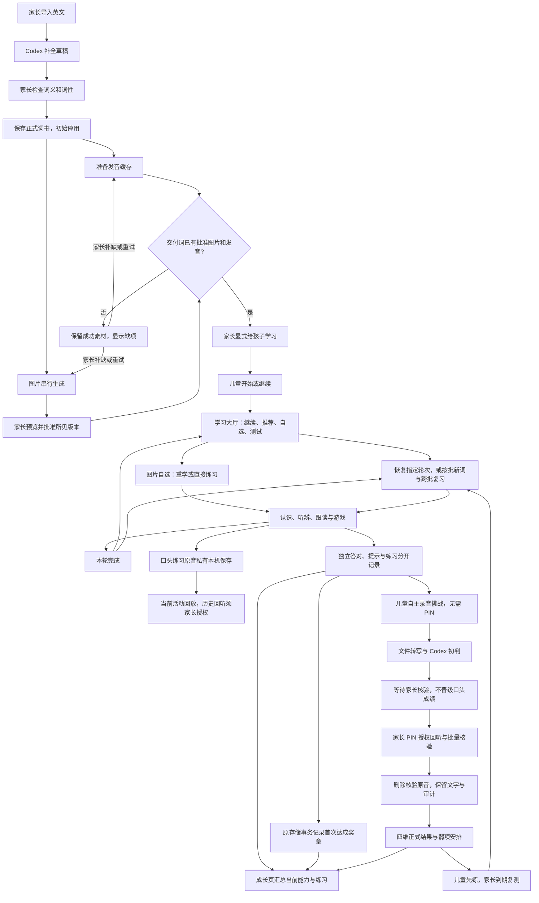

# 项目结构、素材与状态图

本文件固定目录职责和业务状态边界。运行方法见 [README](../README.md)，功能进度见 [任务树](TASK_TREE.md)，本轮验证见 [验收](ACCEPTANCE.md)。

## 固定目录

```text
英语学习/
├─ src/                  儿童与家长界面、浏览器录音和播放
├─ server/               本机 HTTP、SQLite、素材队列与外部服务适配
├─ shared/               接口合同、学习调度、玩法和主题定义
├─ public/assets/        随项目交付的主题图、示例图与占位图
├─ scripts/              启停、备课维护、隔离验收和项目打包
│  └─ legacy/            停用语音阶段的显式维护工具，不进入精简包
├─ tests/                单元及 API 回归测试
├─ docs/                 当前规格、状态、验收与素材清单
│  └─ archive/           历史文档，不作为当前要求，不进入精简包
├─ Work_Progress/        每轮任务证据，保留在工作区
├─ data/                 本机档案、图片、发音、私有挑战/口头练习原音和 PIN
├─ artifacts/            隔离验收、历史素材归档与项目包
├─ dist/                 可重建的网页构建
├─ node_modules/         按 package-lock.json 安装的依赖
├─ .env.example          无密钥配置模板
├─ .env                  仅本机的密钥配置
└─ 启动/停止单词游乐园.cmd
```

`data/`、`.env`、`artifacts/`、`dist/`、`node_modules/` 均不提交。核心代码沿用现有三个目录，不为了目录整齐拆散已验证的模块。

## 单一真源

| 内容 | 真源 | 更新时机 |
| --- | --- | --- |
| 产品边界与接口语义 | `docs/MVP.md`、`shared/contracts.ts` | 功能或接口变化 |
| 学习安排与完成校验 | `shared/learning.ts`、`shared/game-plan.ts`、`server/store.ts` | 学习规则变化 |
| 当前功能进度与待办 | `docs/TASK_TREE.md` | 完成功能或发现限制 |
| 命令、配置与家庭使用 | `README.md`、`package.json` | 启动、配置或操作变化 |
| 结构与素材边界 | 本文件、`docs/ASSETS.json` | 目录职责或静态资产变化 |
| 视觉资源引用 | `shared/visual-theme.ts`、`shared/companions.ts`、`shared/learning-backgrounds.ts` | 切换当前主题或角色 |
| 工作规则 | `AGENTS.md` | 改变后续默认行为或验证门槛 |
| 验收证据 | `docs/ACCEPTANCE.md`、`Work_Progress/`、`artifacts/` | 实际执行验证后 |

历史文档只供追溯。当前状态必须由代码、测试和本机服务复核；不要把旧测试计数、词表数量、账号额度或旧截图当作现状。

## 备课与交付状态图

以下为业务流程，不新增数据库状态字段。



测试中的看、读和双向翻译单独记账，不混入原有听辨或跟读练习。自主挑战的创建、作答、提交免 PIN；核验、回听、重试和旧现场测试需要家长授权，过期或刷新后重新验证。AI 初判是建议，口头正式证据必须经家长确认。

口头练习录音保存不自动完成题目或判对，不进入转写/AI流程；刷新可恢复。成长页区分当前会词量与永久保留的历史奖章，首次发章在既有事实写入事务中记录，界面不提供刷章入口。

至少一词备好后可由家长显式部分交付；未批准图片和未缓存发音不能绕过门槛。重画图片进入待审核，不能默许替换批准版本。服务失败或额度不足保留已有结果，由家长决定重试，不自动充值或切换付费服务。

## 素材固定与清理边界

- 当前静态素材只放在 `public/assets/`，使用稳定文件名。`docs/ASSETS.json` 记录每个文件的大小与 SHA-256；`npm.cmd run assets:check` 检查引用、缺失及意外变更，审核变更后执行 `npm.cmd run assets:update`。
- 示例词插画用于明确开启的示例体验；不得当作家长正式词表。运行中生成的单词图片和发音始终留在 `data/images/`、`data/speech/`，不搬入静态目录或项目包。
- 停用背景和旧头像移出 `public/`，因此不再复制到网页构建和项目包；历史归档位置与清单见本轮任务记录。
- `dist/` 可通过构建更新；`node_modules/` 可按锁文件重装。清理不可递归删除 `data/`、`.env`、批准素材、任务记录或正在运行的隔离验收目录。
- 历史 QA 输出留在忽略的 `artifacts/`。只归档已经停止使用、可确认用途的临时副本；不得因目录名像测试而删除用户档案。

## 精简项目包

运行 `npm.cmd run package:project`，生成 `artifacts/project-package/little-word-playroom.zip` 和 `.sha256`。包中含当前源码、静态资产、测试、当前文档、锁定依赖和双击入口；不含本机凭据、学习档案、音频缓存、依赖目录、构建、历史文档、停用工具、任务日志和验收输出。

`PROJECT_MANIFEST.json` 记录包内文件与哈希，脚本压缩后逐项读回验证。项目包是当前工作区源码快照，不代表 Git 已提交或云端已部署。新电脑解压后按 README 安装、构建，并单独配置外部服务和家长词书。

## 隔离体验与维护工具

| 用途 | 入口 | 数据与要求 |
| --- | --- | --- |
| 游戏批次与 UI | `scripts/game-library-qa.ts`，当前8794/8795体验 | 示例、独立构建和既有 MP3；保留原目录与进度，参数见脚本 |
| 儿童自主挑战 | `scripts/challenge-qa.vite.ts`、`scripts/challenge-qa.ts` | 8798 隔离录音/转写/Codex 替身；不写正式成绩 |
| 旧家长现场测试 | `npm.cmd run build:assessment-experience`、`npm.cmd run assessment:experience` | 8799 独立档案；先确认端口空闲再启动 |
| 学习大厅与跨批复习 | `node --import tsx scripts/learning-hub-qa.ts --port=8811` | 双批次示例与合成历史，独立档案，语音关闭并禁止云调用 |
| 成长汇总 | `scripts/growth-qa.ts` | 示例与合成历史，禁止云调用 |
| 发音维护 | `scripts/cache-word-audio.ts` | 默认只检查；`--apply` 才生成 |

`.env`、学习档案和私有原音不是项目资产清单的内容。口头学习录音按用户要求私有留存，用于孩子回放与家长回听；不套用挑战核验后的自动删除规则。挑战原音按业务规则在家长核验后清理；目录整理不能代替该授权流程，不能批量删掉未核验录音。

启动新的隔离体验前先确认目标端口空闲，必要时显式指定未占用端口；不要停止其他体验进程。当前运行状态以本机监听和健康接口为准，不把脚本默认端口当作已启动服务。
